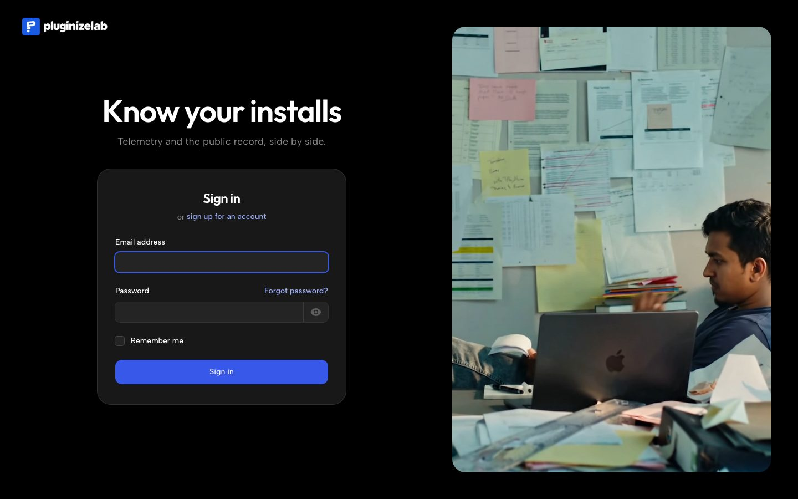
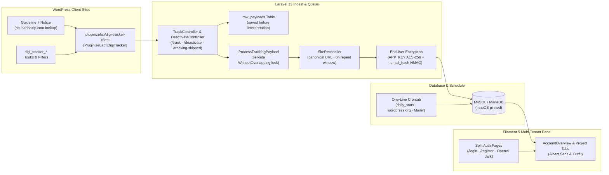
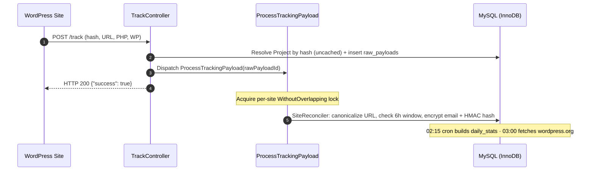

# Case study: Digi Tracker Suite

**Self-hosted WordPress telemetry and public repository analytics on shared hosting**

Between 25 August and 22 September 2026 I built **Digi Tracker Suite** for PluginizeLab, a self-hosted WordPress telemetry application and forked client SDK (`pluginizelab/digi-tracker-client`) that replaces Appsero. It collects opt-in heartbeats and deactivation feedback alongside daily public snapshots from wordpress.org. I made **all 40 commits** on `main` (22 with a Claude co-author trailer) and merged **both pull requests** on GitHub.



| | |
|---|---|
| **My role** | Developer, with Claude Opus 5 as pair |
| **Team** | 1 developer, 1 repository (plus `packages/digi-tracker-client`) |
| **Window** | 25 Aug to 22 Sep 2026 |
| **Deployment** | Deployed to `space.pluginizelab.com` on 27 Aug 2026 (`DEPLOY.md`) |
| **Stack** | Laravel 13, Filament 5, Livewire, PHP 8.3, MySQL / MariaDB, Tailwind CSS v4, PHPUnit 12 |

---

## The weeks (25 Aug to 22 Sep)

Twenty-seven of the 40 commits landed between 25 and 28 August: phases P1 through P6 (ingest, rollup, dashboard, SDK fork, analytics reports, email layer), the Namecheap deployment on 27 August, and the public wordpress.org repository integration. Two commits followed on 31 August for on-demand repository refreshes and the account overview dashboard. The repository was quiet from 1 to 19 September. Five commits on 20 September redesigned the authentication pages, typography, and dark theme, and six commits on 22 September (PRs #1 and #2) added the GitHub Actions deployment workflow.

```text
Commits per week on main (25 Aug to 22 Sep 2026):
24–30 Aug : ███████████████████████████ 27 commits (P1–P6, SDK fork, Namecheap deploy, wordpress.org sync)
31 Aug–6 Sep : ██ 2 commits (On-demand RefreshRepoStats, AccountOverview dashboard)
07–13 Sep : (0 commits)
14–20 Sep : █████ 5 commits (composer dev docs, split auth pages, local fonts, OpenAI dark neutrals, root auth URLs)
21–27 Sep : ██████ 6 commits (GitHub Actions CI/CD deploy workflow and asset build fix, PRs #1–#2)
```

**Totals:** 40 of 40 commits on `main` (`70682eb`), 22 co-authored with Claude, 2 of 2 merged pull requests, 282 PHPUnit tests passing (939 assertions).

---

## The brief (25 Aug)

From [DEPLOY.md](../DEPLOY.md) and [packages/digi-tracker-client/README.md](../packages/digi-tracker-client/README.md), the platform had to receive Appsero-protocol telemetry on infrastructure owned by PluginizeLab while meeting five constraints:

1. **Permanent ingest paths:** `/track`, `/deactivate`, and `/tracking-skipped` are compiled into every released plugin copy and can never be changed once shipped.
2. **WordPress.org Guideline 7 compliance:** Telemetry is strictly opt-in. The consent notice names Digi Tracker and links to our privacy policy, and the deactivation survey only fires when consent was granted.
3. **No third-party IP lookups:** Upstream `appsero/client` queries `icanhazip.com` on every heartbeat. The fork removes that outbound call and derives country on our receiving server.
4. **Encrypted contact details at rest:** Admin emails and names are encrypted with `APP_KEY`, paired with an HMAC blind index (`email_hash`) so records remain searchable without storing plaintext emails.
5. **Shared cPanel hosting:** The server runs on Namecheap shared hosting with SSH, MariaDB, and a single-line per-minute cron job.

---

## The platform: durable ingest, queued reconciliation, and a Filament 5 panel (26 to 27 Aug)

The WordPress SDK posts non-blocking requests (`'blocking' => false`), so a failed parse or dropped request is never retried by the client. [`TrackController`](../app/Http/Controllers/Ingest/TrackController.php) and [`DeactivateController`](../app/Http/Controllers/Ingest/DeactivateController.php) resolve the project from its UUID `hash`, write the raw request to `raw_payloads` before any interpretation, dispatch [`ProcessTrackingPayload`](../app/Jobs/ProcessTrackingPayload.php) to the database queue, and return `200 {"success": true}` immediately.



In the panel, [`Account`](../app/Models/Account.php) is the Filament 5 tenant (`/admin/{account-slug}/...`). Because Filament only scopes queries built by its own resources, an Eloquent global scope backed by `CurrentAccount` stays active so custom widgets and services cannot leak rows across tenants.

---

## Ingest, metadata whitelist, and the nightly rollup (26 to 27 Aug)

P1 (`34638e9`) and P2 (`3b44fd7`) built the three ingest routes (`/track`, `/deactivate`, `/tracking-skipped`), the `extra[]` metadata whitelist, plugin inventory sync, GeoIP lookup, site status classification, anomaly detection, and the `daily_stats` rollup. P3 (`5ea4a31`, `4cd069e`) tried a hand-written TailAdmin Blade dashboard first and replaced it 15 minutes later with Filament 5 while keeping [`DashboardMetrics`](../app/Services/DashboardMetrics.php) and the three bug fixes the first pass uncovered.

```text
25 Aug 18:53  Initial commit
26 Aug 02:32  P1: tenancy skeleton and telemetry ingest
27 Aug 15:58  P2: full event coverage, metadata whitelist, and the nightly rollup
27 Aug 16:14  P3: dashboard on the TailAdmin template, replacing Filament
27 Aug 16:29  P3: rebuild the dashboard on Filament, replacing TailAdmin
27 Aug 16:31  Schedule the queue worker so the crontab is one line
```

- **Form-encoded booleans:** WordPress's `http_build_query` sends booleans as `"1"` and `""`. Standard Laravel `boolean` validation rejects empty strings, so `TrackRequest` reads them through explicit accessors.
- **Uncached project lookup:** Caching an Eloquent `Project` model in the MySQL database cache store stripped the NUL bytes marking protected properties and unserialized as `__PHP_Incomplete_Class`. Caught during a live run and fixed in `3b44fd7` by querying uncached.
- **6-hour repeat window:** Identical heartbeats within six hours update `last_seen_at` on `sites` without inserting a duplicate `site_reports` row, preventing a misconfigured cron from weighting one site multiple times.
- **Reactivation on the deactivation row:** `sites` holds current state only. Stamping `reactivated_at` on the `deactivations` row lets `daily_stats` answer how many sites returned on a past date.

---

## Forking `appsero/client` and closing two upstream consent holes (27 Aug)

Commit `d77d96f` forked `appsero/client` v2.0.4 (MIT) into [`packages/digi-tracker-client`](../packages/digi-tracker-client/README.md) under GPL-2.0-or-later. `dokan-lite` bundles `appsero/client` unscoped in the global `Appsero\` namespace behind `if ( ! class_exists( 'Appsero\Client' ) )`. Keeping that namespace on a site running Dokan would cause Dokan's unmodified client to load first and silently send our plugin's telemetry to Appsero's servers.

| Upstream `appsero/client` | `digi-tracker-client` fork | Why (`README.md` & `44abd21`) |
|---|---|---|
| Global `Appsero\` namespace and `appsero_*` filters | `PluginizeLab\DigiTracker` and `digi_tracker_*` filters | Prevents class and filter collisions when another plugin bundles Appsero |
| Queries `icanhazip.com` on every heartbeat | Removed (`ip_address` sent empty for wire compatibility) | Stops undisclosed outbound requests to a third party; country is resolved on the server |
| Deactivation route fires without checking consent | Gated behind `tracking_allowed()` (`44abd21`) | Upstream sent URL, admin email, name, and plugin list from users who clicked "No thanks" |
| `/tracking-skipped` stored IP and user agent | `ip` and `user_agent` columns dropped (`44abd21`) | User agent contains `md5(home_url)`; storing it turned a refusal into a record of who refused |
| `Client::updater()` and `Client::license()` | Removed | Plugins are free on wordpress.org; dead accessors for unshipped classes would fatal |

Commit `fd6a2c1` excluded `packages/` from Laravel Pint and restored upstream's WordPress formatting so the fork differs by about 60 lines per file. Commit `177c6b9` added an `mu-plugin` harness to test the SDK against a local WordPress install (`Metadata Viewer`) without editing the plugin's own source.

---

## Analytics depth, GDPR erasure, and a single-choke-point email layer (27 Aug)

Commits `3550c54`, `9d1153f`, and `11e74aa` added the reproducible demo generator ([`SeedDemoTelemetry`](../app/Console/Commands/SeedDemoTelemetry.php) with `--seed`), which drives synthetic payloads through [`SiteReconciler`](../app/Services/SiteReconciler.php) rather than bulk-inserting rows, and [`ForgetTelemetry`](../app/Console/Commands/ForgetTelemetry.php) (`telemetry:forget`), which deletes a site or email across `sites`, `raw_payloads` (which sits outside foreign keys), and any `end_users` left owning zero sites.

P5 (`2042ba9`) added the project Reports page: version adoption stacked by percentage share rather than raw count, churn by theme calculated as a rate (excluding themes with fewer than 5 installs), and CSV exports with explicit per-call-site column lists so aggregate-only plugin inventories can never be exported.

P6 (`4ae69f7`) placed four email surfaces (deactivation auto-responder, deactivation forward to author, weekly Monday digest, and per-project branding) behind a single [`Mailer`](../app/Services/Mailer.php) service. Because telemetry opt-in is consent to be measured rather than marketed to, the auto-responder fires only when a user typed a comment in the deactivation dialog, once per person per project. Unsubscribe links require no login, support RFC 8058 one-click `POST`, and store suppressions by HMAC blind index in `email_suppressions`.

---

## Deploying to Namecheap cPanel: four assumptions the server broke (27 Aug)

Deploying to `space.pluginizelab.com` on 27 August (`0ae456f` and [DEPLOY.md](../DEPLOY.md#L56-L150)) exposed four differences between local development (MySQL 9 on Herd) and the production Namecheap shared host (CloudLinux, LiteSpeed, MariaDB 11.4.12 behind Cloudflare):

| Request (`DEPLOY.md` §0a, 27 Aug 2026) | Through Cloudflare proxy | Straight to origin (`198.54.116.227`) |
|---|---|---|
| `POST /track`, realistic payload | **10 / 25 arrived** (40%) | **15 / 15 arrived** (100%) |
| `POST /livewire-.../update` | **6 / 12 arrived** (50%) | **12 / 12 arrived** (100%) |
| `POST /deactivate` | — | **10 / 10 arrived** (100%) |
| `GET /up`, `GET /admin` | Fine | Fine |

- **Cloudflare dropped half of POSTs:** Proxied POST requests died mid-connection (curl exit codes 35/55/56, no HTTP status). Because the SDK sends fire-and-forget POSTs, dropped `/track` requests silently under-counted installs and broke half of Livewire's panel updates. The ingest hostname is therefore DNS-only (`A` record to `198.54.116.227`), and `config/proxies.php` trusts Cloudflare's IP ranges rather than `'*'`.
- **MariaDB defaulted to MyISAM:** Migrations failed on utf8mb4 1000-byte key limits. Worse, MyISAM lacks `SELECT ... FOR UPDATE` row locks and transactions, which would have let overlapping per-minute queue workers send duplicate auto-responders and fired `DB::afterCommit()` prematurely. `config/database.php` now pins `'engine' => env('DB_ENGINE', 'InnoDB')`.
- **Split document root:** cPanel locks the subdomain root to `~/space.pluginizelab.com`. `deploy/deploy.sh` keeps the application outside the web root at `~/digi-tracker`, copies `public/` into the docroot with rewritten `index.php` paths, and copies `public/build/` to both locations so Blade's `@vite` manifest check and the web server agree.
- **PHP 8.3 via CloudLinux handler:** `/opt/cpanel/ea-php*` stopped at 8.2 and `selectorctl --domain` silently failed to create its CageFS directory. PHP 8.3.33 lived under `/opt/alt/php83`, pinned per-docroot via `AddHandler application/x-httpd-alt-php83___lsphp .php` in `.htaccess`.



---

## Putting the public wordpress.org record beside private telemetry (27 to 31 Aug)

Commits `8d7889e`, `5cda5a6`, `fa34b5f`, `938ee2c`, and `937bd6c` added public repository intelligence via [`WordPressOrg`](../app/Services/WordPressOrg.php) and [`RepoSnapshotter`](../app/Services/RepoSnapshotter.php). Until released plugins ship with the new SDK, private telemetry reads zero while the plugins on wordpress.org already have years of history. Leading with the public Repository tab and placing tracked installs over public `active_installs` gives the true opt-in rate.

| wordpress.org API / SVN quirk (`8d7889e`, `fa34b5f`) | What went wrong initially | Fix in `WordPressOrg` / `RepoSnapshotter` |
|---|---|---|
| `downloaded` omitted from default `plugin_information` fields | Missing key read as `0` lifetime downloads on every snapshot | Explicitly request `fields[downloaded]=1` |
| Daily downloads API caps at 730 days and silently falls back to 180 | Summing daily rows reported 57,988 lifetime downloads for `wp-change-email-sender` instead of 78,203 | Clamp history requests to 730 days and read `downloads.php?historical_summary=1` for headline totals |
| `limit=N` returns `N-1` days ending yesterday (unless `limit=1`) | Today's downloads were missing and rendered as a dash | Fetch the 4-window summary live (cached 15 minutes, falling back to the last snapshot on error) |
| No wordpress.org API for version release dates | Days-to-50% adoption was parked in P5 as unbuildable | One `WebDAV PROPFIND` request to `plugins.svn.wordpress.org` recovers tag creation dates back to 2021 |

Commit `938ee2c` added [`RefreshRepoStats`](../app/Jobs/RefreshRepoStats.php) so linking a project or clicking Refresh captures the public record immediately via the queue (throttled by a shared cache cooldown key), and `937bd6c` replaced the default projects list landing page with [`AccountOverview`](../app/Services/AccountOverview.php), using a `joinSub` on `max(date)` per project so a quiet plugin never looks like installs dropped to zero.

---

## Client-side navigation, split auth pages, and OpenAI dark neutrals (28 Aug & 20 Sep)

On 28 August (`5c0f6ac`, `0f492c5`) I added transactional organisation sign-up (gated by `TELEMETRY_REGISTRATION`), password reset without account-enumeration leaks, and Livewire `wire:navigate` (`spa()`) across the panel with auth routes excluded and hover prefetching disabled so hovering a tab never triggers live requests to wordpress.org.

On 20 September (`30d3e18`, `392df1a`, `67f0478`, `f1a58d2`) I redesigned the authentication screens and panel typography:

- **Split auth layout (`30d3e18`):** `/login`, `/register`, and `/password-reset/*` place the brand and a 28rem form column on the left and a muted looping video (`public/media/auth.mp4` with `auth-poster.jpg`, paused under `prefers-reduced-motion`) pinned on the right above 1024px.
- **Local variable fonts (`392df1a`):** Replaced Filament's Bunny Fonts Inter request with self-hosted `@fontsource-variable/albert-sans` for body copy and `@fontsource-variable/outfit` for headings and KPI stat values.
- **Dark by default on OpenAI neutrals (`67f0478`):** Remapped Filament's `--gray-*` tokens on `html.dark` to the `openai.com/codex` neutral scale. Auth pages force `.dark` before first paint and sync Filament's Alpine theme store in memory without overwriting a user's saved panel preference.
- **Root auth URLs (`f1a58d2`):** Subclassed Filament's `Panel` (`App\Filament\AdminPanel`) to mount `/login`, `/register`, and `/password-reset/*` at the root while keeping `/admin/password-reset/reset` active so previously emailed signed links stay valid for their full hour.

---

## The details a visitor never sees

- **282 PHPUnit tests on real MySQL:** `phpunit.xml` runs against MySQL (`digi_tracker_test`) rather than SQLite because JSON semantics differ. Base `TestCase` calls `Http::preventStrayRequests()`, stubbing wordpress.org with `metadata-viewer`'s real figures (`10 / 9 / 63 / 4,468`).
- **Read-only host preflight (`3b8b2fd`):** `deploy/preflight.sh` checks PHP version, `proc_open`, cron, and required extensions via `php -r` rather than `php -m | grep -q`, avoiding a `SIGPIPE` false failure under `set -o pipefail`.
- **GitHub Actions deploy pipeline (PRs #1–#2):** Merged on 22 September (`36c72f2`, `70682eb`). Runs the PHPUnit suite against `mariadb:11.4`, installs Composer dependencies so `@tailwindcss/vite` can resolve Filament's CSS in `vendor/`, executes `deploy/deploy.sh`, and smoke-tests `GET /login` (200) and `GET /.env` (404).
- **`composer dev` supervision (`6028cad`):** [CLAUDE.md](../CLAUDE.md) and [AGENTS.md](../AGENTS.md) instruct agents to run `composer dev` (`artisan dev`) rather than `npm run dev`, after 7 queued `RefreshRepoStats` jobs sat at `attempts=0` for three weeks because Vite alone leaves `queue:listen` unstarted.

---

## Working with Claude Opus 5

All 40 non-merge commits on `main` were made in my sessions: 18 without a co-author trailer, 16 with a `Co-Authored-By: Claude Opus 5` trailer, and 6 in PRs #1 and #2 generated in a Claude Code web session (`session_01ESHScKBaVovXQz1dE3g2A7`) and merged by me.

| Commits without co-author trailer (18) | Paired with Claude (22 commits, incl. PRs #1–#2) |
|---|---|
| P2 event coverage, metadata whitelist, GeoIP, anomaly detection, and `daily_stats` rollup (`3b44fd7`) | P1 tenancy skeleton and Appsero-protocol ingest (`34638e9`) |
| P3 dashboard passes on TailAdmin and Filament 5 (`5ea4a31`, `4cd069e`) and one-line cron worker (`7a9e4e7`) | Namecheap deployment fixes (`0ae456f`) and PluginizeLab panel branding (`f9f3f49`) |
| P4 `pluginizelab/digi-tracker-client` SDK fork, `mu-plugin` harness, and closing two upstream consent holes (`d77d96f`–`44abd21`) | Public wordpress.org repository capture, SVN release dates, download chart windows, and on-demand refresh (`8d7889e`–`fa34b5f`, `938ee2c`) |
| Demo corpus generator, reproducible `--seed`, and `telemetry:forget` cascade erasure (`3550c54`, `9d1153f`, `11e74aa`) | Account Overview dashboard (`937bd6c`), sign-up & password reset (`5c0f6ac`), and `wire:navigate` SPA mode (`0f492c5`) |
| P5 analytics reports & CSV export (`2042ba9`), P6 email layer (`4ae69f7`), and Namecheap preflight & runbook (`3b8b2fd`, `107079b`, `82cab1c`) | Split auth layout, Albert Sans & Outfit fonts, OpenAI dark neutrals, root auth routes (`30d3e18`–`f1a58d2`), and GitHub Actions CI/CD (PRs #1–#2) |

---

## Where Digi Tracker Suite stands

- **Deployed on shared hosting:** Deployed to `space.pluginizelab.com` on 27 August 2026 (`DEPLOY.md` §0a) with a split docroot, InnoDB pinned, and a single-line crontab.
- **Public wordpress.org analytics live:** Captures daily downloads, active installs, ratings, keyword rankings, and SVN tag release dates across PluginizeLab's plugins (`metadata-viewer`, `wp-change-email-sender`, and others).
- **Forked SDK ready for plugin releases:** `packages/digi-tracker-client` ships under `PluginizeLab\DigiTracker` (GPL-2.0-or-later) with upstream's `icanhazip.com` lookup removed and deactivation consent holes closed.
- **282 tests, 939 assertions:** Verified with PHPUnit 12 against MySQL with zero stray network requests (`Http::preventStrayRequests()`).

---

## Where the numbers come from

Commit counts come from `git_stats.py` on `main` (`70682eb`, 25 August to 22 September 2026, Asia/Dhaka) with author patterns `eng.aminurislam@gmail.com`, `Aminur`, and `Claude`, since the 6 commits in PRs #1 and #2 were made in my Claude Code session and count as mine: 40 non-merge commits total, 22 carrying a Claude co-author trailer. Commit counts measure activity, not effort. The Cloudflare POST arrival rates (10/25 on `/track`, 6/12 on Livewire updates vs 15/15 and 12/12 direct to origin) were measured on 27 August 2026 and recorded in `DEPLOY.md` section 0a. The test count (282 tests, 939 assertions) was measured by running `php artisan test` against PHP 8.3.36 and MySQL on 8 November 2026.

**Files:** [standalone.html](./standalone.html) · [case-study.md](./case-study.md) · [case.json](./case.json) · [stats.json](./stats.json)
